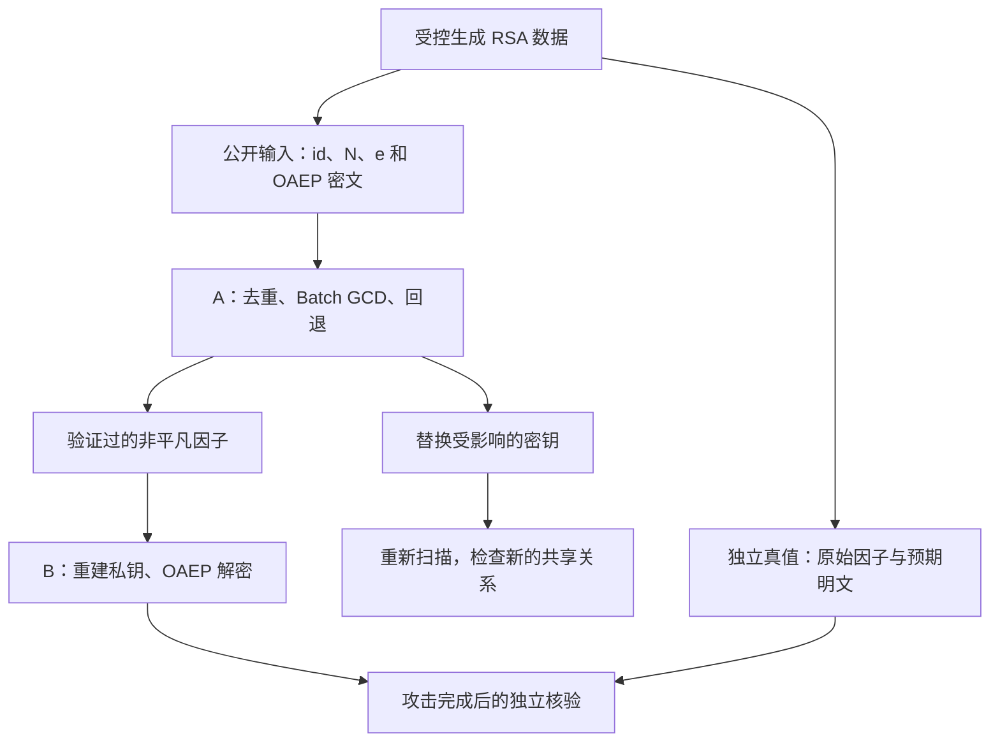

# 从头理解我们的 RSA 共享素因子项目

整理日期：2026-10-17。本文对照当前的 `rsa_audit/`、`rsa_lab/`、`artifacts/` 和最终十页展示编写。文中的正式实验数字来自归档；小整数专门用于推导，不能与真实 2048-bit 实验混用。

这是一份学习文档。目标是让你能解释“为什么数学上成立、代码如何实现、实验如何核验”，然后再去讲演示页上的代码。

## 阅读路线

第一次按顺序读第 1–10 节，先把攻击和 Batch GCD 推导完整。第二次读第 11–16 节，把数学接到代码和实验。最后做第 19 节的练习，再用第 18 节检查答辩表达。

你负责 A，所以第 5–10 节尤其重要；但第 11 节的私钥恢复和 OAEP 也必须理解，否则很难把“找到一个因子”与“恢复明文”连起来。

目录：

- [1. 我们到底做了什么](#project)
- [2. 必须先懂的数学与符号](#math)
- [3. RSA 为什么能够加密和解密](#rsa)
- [4. 共享一个素因子为什么会暴露私钥](#shared-prime)
- [5. Pairwise GCD：最直接的检测方法](#pairwise)
- [6. Batch GCD 的核心等式](#batch)
- [7. Product tree：怎样组织乘法](#product-tree)
- [8. Squared remainder tree：怎样批量求余](#remainder-tree)
- [9. 去重、全重叠与回退](#edge-cases)
- [10. 你的 A 代码怎样落实这些数学](#a-code)
- [11. B 怎样恢复私钥并解密 OAEP](#recovery)
- [12. 数据怎样构造，怎样避免使用答案攻击](#data)
- [13. 现有实验结果应该怎样理解](#experiments)
- [14. 编码、哈希和第三方库各做什么](#engineering)
- [15. 文件与代码阅读顺序](#files)
- [16. 自己运行并观察结果](#run)
- [17. 十页展示分别在证明什么](#presentation)
- [18. 答辩时容易说错的地方](#defense)
- [19. 自测题与参考答案](#practice)
- [20. 参考资料与核验说明](#references)

<a id="project"></a>
## 1. 我们到底做了什么

项目研究的问题是：**如果不同 RSA 公钥的模数重复使用了某个秘密素数，能不能仅从公开信息发现这种关系，进一步恢复私钥和明文？**

我们完成的流程是：



其中，真值只能进入后面的核验阶段，不能先给检测器提供 `p、q、d`。

先把项目放进密码学的整体分类里：**对称加密**让通信双方共享一把秘密密钥；**非对称加密**使用公开加密钥匙与秘密解密钥匙，RSA 是这一类。别人可以取得你的公钥并给你加密消息，但应当只有掌握对应私钥的人能解密。**哈希**通常不需要秘密钥匙，把数据变成摘要，本身不是可逆加密。**数字签名**主要解决来源与消息校验问题，与这里“公钥加密、私钥解密”的实验目的不同；本项目没有实现完整签名方案。

我们已经完成以下工作：

| 部分 | 完成内容 | 你需要理解的核心 |
|---|---|---|
| A：检测引擎 | 两两 GCD、乘积树、平方模数余数树、去重、全重叠回退、状态与计时 | 从一批公开模数找到可验证的因子 |
| B：实验与恢复 | 数据生成、私钥重建、OAEP、独立评估、性能和弱池实验、换钥 | 证明检测正确，并展示私钥泄露的后果 |
| 最终展示 | 十页 HTML、数学动画、归档图表、实际 Python 流水线、两页代码 | 区分数学解释、历史实测、现场重算 |

正式演示中有 **102 条记录、100 个不同模数、5 个被分解的不同模数、6 条核对成功的明文**。这些数字描述的是不同对象，后面会逐项解释。

项目没有实现 Wiener attack。我们的攻击入口是**不同公钥之间的共享因子关系**，不需要私钥指数 `d` 特别小，也没有分解任意正常生成的 RSA-2048 模数。

<a id="math"></a>
## 2. 必须先懂的数学与符号

### 2.1 先统一符号

| 符号 | 含义 | 是否公开 |
|---|---|---|
| `p、q` | 两个不同的大素数 | 应保密 |
| `N = p × q` | RSA 模数 | 公开 |
| `e` | 公钥指数，本项目真实数据通常为 65537 | 公开 |
| `d` | 私钥指数 | 应保密 |
| `m、c` | RSA 运算中的消息整数、密文整数 | `c` 可以公开，`m` 希望保密 |
| `φ(N)` | 欧拉函数；两个不同素数时为 `(p−1)(q−1)` | 能由因子算出 |
| `λ(N)` | 本项目使用 `lcm(p−1, q−1)` | 能由因子算出 |
| `k` | 本文算法章节中表示不同模数的个数 | 例如正式演示为 100 |
| `P` | 一批不同模数的总乘积 | 由公开模数计算 |
| `Q_i` | 除了 `N_i` 之外的其他模数之积 | `P / N_i` |
| `r_i` | `P mod N_i²` | 余数树的叶节点输出 |
| `g_i` | `gcd(N_i, r_i / N_i)` | 最终检测值 |

注意大小写：小写 `p` 是一个素因子；大写 `P` 是整批模数的乘积。它们不是同一个量。

### 2.2 什么是“2048 位”

素数是大于 1、只有 1 和自己两个正因子的整数，例如 3、5、7、11。合数可以拆成更小整数的乘积。RSA 的 `N=pq` 是合数；知道乘积却不知道两个秘密素数，与事先知道素数再算乘积，是难度很不一样的任务。

实际模数的位长满足：

```text
2^2047 ≤ N < 2^2048
```

因此是 `N.bit_length() == 2048`。这是**二进制位数**，不是 2048 个十进制数字，也不是 2048 字节。2048 bit 对应 256 字节。

本项目从约 1024-bit 的素数构造模数，但两个 1024-bit 素数的乘积也可能只有 2047 bit，所以生成器还会检查乘积的实际位长，而不只看生成参数。

### 2.3 取模：只保留余数

`a mod b` 表示 `a` 除以 `b` 的余数。例如：

```text
17 = 3 × 5 + 2，所以 17 mod 5 = 2。
17 ≡ 2 (mod 5)，表示 5 整除 17−2。
```

取模不等于普通除法。`1 / 17` 是普通分数；“17 在模 30 下的逆元”是另一个整数问题。

### 2.4 GCD：最大公因数

`gcd(a,b)` 是同时整除 `a` 和 `b` 的最大正整数。欧几里得算法不断用余数替换原来的数：

```text
91 = 1 × 77 + 14
77 = 5 × 14 + 7
14 = 2 × 7  + 0
```

最后一个非零余数是 7，所以 `gcd(91,77)=7`。

两个数的 GCD 为 1，称为互素。求 GCD 只需要做一连串除法取余，通常远比尝试直接分解一个大合数容易。

### 2.5 模逆：RSA 私钥恢复的关键

`d = e⁻¹ mod L` 的意思是找到一个整数 `d`，使：

```text
e × d ≡ 1 (mod L)
```

存在模逆的条件是 `gcd(e,L)=1`。例如：

```text
17 × 23 = 391 = 13 × 30 + 1
所以 17⁻¹ mod 30 = 23。
```

扩展欧几里得算法可以找出 `17x+30y=1` 的整数解。这里 `x=23、y=−13` 就是一组解。Python 的 `pow(17, -1, 30)` 会计算这个模逆。

`lcm(a,b)` 是最小公倍数，与 GCD 的关系为 `lcm(a,b)=a×b/gcd(a,b)`，其中 `a、b` 为正整数。

<a id="rsa"></a>
## 3. RSA 为什么能够加密和解密

### 3.1 密钥生成的数学步骤

在本项目的两素数 RSA 模型中：

1. 选择两个不同的大素数 `p、q`。
2. 计算 `N=pq`。
3. 计算 `λ(N)=lcm(p−1,q−1)`。
4. 选择满足 `gcd(e,λ(N))=1` 的公开指数 `e`。
5. 求 `d=e⁻¹ mod λ(N)`。

公钥主要是 `(N,e)`。私钥可以用 `(N,d)` 描述基本运算；密码库常同时保存 `p、q` 和 CRT 参数，以便检查并加速运算。

`e=65537=2^16+1` 是公钥参数，不是密码，也不需要隐藏。本项目的因子检测甚至不依赖 `e` 的具体值，但私钥恢复必须使用每条记录自己的 `e`。

这些 RSA 参数关系可对照 [RFC 8017 的密钥定义](https://www.rfc-editor.org/rfc/rfc8017.html#section-3)。

### 3.2 先看教科书 RSA 运算

把消息表示为 `0≤m<N` 的整数，基本 RSA 运算是：

```text
加密：c = m^e mod N
解密：m = c^d mod N
```

为什么能解回来？因为 `ed=1+tλ(N)`。对与 `N` 互素的消息，有 `m^λ(N)≡1 mod N`，所以：

```text
m^(ed) = m × (m^λ(N))^t ≡ m (mod N)
```

这里有一个细节：消息不一定与 `N` 互素。完整说明可以分别在模 `p` 和模 `q` 下考虑：若消息被该素数整除，等式两边都为 0；否则用费马小定理。再由中国剩余定理，合并得到模 `N` 下相同的消息。不能只用“所有消息都互素”来证明 RSA。

### 3.3 一个完整的小整数例子

取 `p=7、q=11、e=17`：

| 步骤 | 计算 |
|---|---|
| 模数 | `N=7×11=77` |
| 欧拉函数 | `φ(N)=6×10=60` |
| 本项目采用的群指数 | `λ(N)=lcm(6,10)=30` |
| 私钥指数 | `d=17⁻¹ mod 30=23` |
| 选择消息整数 | `m=20` |
| 加密 | `c=20^17 mod 77=48` |
| 解密 | `48^23 mod 77=20` |

你可以直接验证：

```python
from math import lcm

p, q, e = 7, 11, 17
n = p * q
lambda_n = lcm(p - 1, q - 1)
d = pow(e, -1, lambda_n)
c = pow(20, e, n)
assert (n, lambda_n, d, c, pow(c, d, n)) == (77, 30, 23, 48, 20)
```

### 3.4 为什么有人用 φ，而我们的代码用 λ

对两个不同素数，`φ(N)=(p−1)(q−1)`，而 `λ(N)` 取两者的最小公倍数。`λ(N)` 整除 `φ(N)`，不一定等于它。

在上面的例子中，模 60 的逆元可以取 53，模 30 的逆元为 23。两种选法都能得到有效 RSA 运算；我们实现明确用 `λ(N)`，答辩时应与代码一致。

### 3.5 RSA 安全性与本项目的关系

给定 `p、q`，求 `d` 很直接；正常生成的大模数只有 `(N,e)` 时，找到素因子应当很困难。我们的攻击利用额外的公钥关系，让“求两个公开整数的 GCD”代替“单独分解一个大数”。

不要把这个过程说成已经证明“RSA 求逆问题与整数分解完全等价”，也不要说“2048 位 RSA 都能很快破解”。这里证明的是：**共享素因子这一特殊结构会使这些密钥失去保密性。**

<a id="shared-prime"></a>
## 4. 共享一个素因子为什么会暴露私钥

设两个不同公钥的模数为：

```text
N₁ = p × q₁
N₂ = p × q₂
```

在标准两素数情形下，如果它们恰好共享素数 `p`，其他因子不同，则：

```text
gcd(N₁,N₂) = p
```

随后计算 `q₁=N₁/p、q₂=N₂/p`，再分别计算各自的 `λ` 和 `d`，就能重建两把私钥。

演示的小例子正是：

```text
77 = 7 × 11
91 = 7 × 13
gcd(77,91) = 7
```

对 `N=77、e=17`，得到 `d=23`；对 `N=91、e=17`，`λ=lcm(6,12)=12`，得到 `d=5`。共享因子相同，不代表私钥指数也相同。

### 4.1 攻击者需要知道什么

| 阶段 | 需要输入 | 不需要提前知道 |
|---|---|---|
| 检测共享因子 | 一批公开模数 `N_i` | 原始素数、私钥、明文 |
| 重建私钥 | 当前公钥 `(N,e)` 和刚求出的非平凡因子 | 生成时保存的私钥 |
| 解密 OAEP | 重建的私钥、密文、公开的 OAEP 参数 | 生成时保存的明文 |
| 评估实验是否正确 | 攻击输出与独立真值 | 这一步不属于攻击输入 |

### 4.2 这种弱点与随机性有什么关系

密钥生成不仅要求“数很大”，还要求素数选择具有足够的不确定性。若设备的随机源有缺陷、状态重复，或只从很小的候选集合选择素数，不同密钥可能出现重复因子。

本项目没有破解某个真实随机数发生器。我们使用密码库取得大素数，再**有意重复使用某些素数**，构造可验证的受控模型。它展示弱随机性可能造成的一种后果，不模拟真实设备的所有生成过程。

这里的“熵”可以先理解为攻击者面对秘密选择时有多大不确定性。一个素数即使有 1024 bit，如果总是在少数固定候选中选择，位长很大也不代表选择空间足够大。密码学伪随机数发生器可以从秘密内部状态扩展输出，关键在于合适的设计、可靠的初始熵和正确使用；普通的固定 seed 伪随机选择不能因此当作秘密素数的可靠生成方式。

这类现象的现实研究背景可阅读 [Mining Your Ps and Qs](https://www.usenix.org/conference/usenixsecurity12/technical-sessions/presentation/heninger)。我们的数据规模、生成方式和结果均属于本地课程实验，不等同于论文的网络测量结果。

<a id="pairwise"></a>
## 5. Pairwise GCD：最直接的检测方法

如果只有几把公钥，直接对每一对不同模数求 GCD 就可以：

```python
from math import gcd

numbers = [15, 21, 143]
for i in range(len(numbers)):
    for j in range(i + 1, len(numbers)):
        print(i, j, gcd(numbers[i], numbers[j]))
```

结果依次为 3、1、1。因此 15 和 21 可以分解，143 在这个集合中未发现共享因子。

若有 `k` 个不同模数，不重复检查的数对有：

```text
k(k−1) / 2
```

| 不同模数数 k | Pairwise 的 GCD 次数 |
|---|---:|
| 100 | 4,950 |
| 1,000 | 499,500 |
| 3,000 | 4,498,500 |

这就是二次增长。它容易实现、容易检查，适合作为基线；但数据量增大时，重复比较太多。

我们保留 Pairwise 并不是因为最终只能做这一种算法，而是要有一个可靠对照：同一批公钥、同一个大整数后端，两种算法应找到一致的可恢复因子。

<a id="batch"></a>
## 6. Batch GCD 的核心等式

### 6.1 先把“与所有其他模数比较”写成一个式子

输入先按模数去重，记不同模数为 `N₁,…,N_k`。定义：

```text
P   = N₁ × N₂ × … × N_k
Q_i = ∏_{j≠i} N_j = P / N_i
g_i = gcd(N_i, Q_i)
```

`Q_i` 汇总了所有其他模数的因子信息。若 `N_i` 的某个素因子也在其他模数里，GCD 就有机会发现它。

但如果对每个 `N_i` 都独立构造一个巨大 `Q_i`，会重复做大量工作。Batch GCD 要做的，是共享中间计算。

### 6.2 为什么对 N² 求余，而不是直接对 N 求余

因为 `N_i` 本来就是 `P` 的因子：

```text
P mod N_i = 0
```

如果只对 `N_i` 求余，所有结果都为 0，失去了区别。

现在改为：

```text
r_i = P mod N_i²
```

利用 `P=N_iQ_i` 推导。按带余除法，把 `Q_i` 写成：

```text
Q_i = aN_i + b，0≤b<N_i
```

两边乘以 `N_i`：

```text
P = aN_i² + bN_i
```

其中 `0≤bN_i<N_i²`，所以：

```text
r_i = bN_i = N_i × (Q_i mod N_i)
r_i / N_i = Q_i mod N_i
```

再用 GCD 的基本性质 `gcd(a,b mod a)=gcd(a,b)`，得到：

```text
gcd(N_i, r_i / N_i) = gcd(N_i, Q_i)
```

**平方模数保留了这样一种余数：先含有一个完整的 N_i，除掉它后，还保留其他模数乘积在模 N_i 下的信息。** 这就是整套算法最关键的数学理由。

### 6.3 三种 GCD 结果

| 结果 | 数学含义 | 下一步 |
|---|---|---|
| `g_i=1` | 当前集合未提供共享因子 | 记录 `no_shared_factor` |
| `1<g_i<N_i` | 找到非平凡因子 | 验证整除，保存因子和余因子 |
| `g_i=N_i` | 整个模数都被其他模数的乘积覆盖 | 需要回退拆分，不能当作成功分解 |

上面的核心流程与 [论文第 3.3 节的 Algorithm 1](https://www.usenix.org/system/files/conference/usenixsecurity12/sec12-final228.pdf#page=5) 对应。我们在其基础流程周围实现了输入校验、去重映射、回退预算、状态和工程验证。

<a id="product-tree"></a>
## 7. Product tree：怎样组织乘法

### 7.1 乘积树存的是什么

每个叶子存一个模数，父节点存两个子节点的乘积。以 `[15,21,143]` 为例：

```text
                45045
               /     \
            315       143
           /   \       |
         15    21      143
```

右边没有配对的末项直接上提，并不再乘一次。代码用“从叶子到根”的层列表表示：

```python
[
    [15, 21, 143],
    [315, 143],
    [45045],
]
```

层数大约随 `log₂k` 增长。它既组织了总乘积的计算，也提供了后面余数树需要的子集乘积。

不要只说“树让乘法次数变少”。计算总乘积本来就只需约 `k−1` 次乘法；树的价值还在于平衡不同位长的运算、保留可复用的子集结构，让后面的批量求余不必逐个从头处理总乘积。

### 7.2 代码怎样处理奇数个节点

在 [rsa_audit/trees.py](rsa_audit/trees.py) 的 `product_tree()` 中：

```python
for left in range(0, len(children), 2):
    check("product_tree")
    if left + 1 < len(children):
        parents.append(children[left] * children[left + 1])
    else:
        parents.append(children[left])
```

`left` 每次加 2；有右邻居就相乘，没有就原样上提。这个规则保证下一节中的父索引 `index // 2` 始终对应正确位置。

<a id="remainder-tree"></a>
## 8. Squared remainder tree：怎样批量求余

### 8.1 为什么不能让每个叶子都独立处理 P

目标是得到所有 `P mod N_i²`。如果对每个模数独立使用完整的巨大 `P` 做除法，相同的高层处理会被重复很多次。

余数树从根开始，沿乘积树向下，把大问题逐层缩小。每个节点保存的量满足不变量：

```text
节点的子树乘积为 V 时：remainder = P mod V²
```

“不变量”就是在算法执行过程中始终保持成立的数学条件，它帮助我们证明代码没有算错对象。

### 8.2 为什么父余数可以继续给孩子取模

设父节点乘积为 `V`，某个孩子乘积为 `W`。由于 `W` 整除 `V`，所以 `W²` 整除 `V²`。

如果父余数为 `R=P−aV²`，对 `W²` 求余时，减去的 `aV²` 仍是 `W²` 的整数倍，于是：

```text
(P mod V²) mod W² = P mod W²
```

因此，孩子不必再次读取完整总乘积；只需要读取对应父节点的余数。

根节点的 `V=P`。所有模数都大于 1，所以根余数为 `P mod P²=P`，这解释了初始化为什么直接使用 `P`。

### 8.3 你的核心代码：逐句读懂

下面是 `squared_remainders()` 的主体摘录；它依赖函数参数 `tree、check`，不是独立的完整脚本：

```python
    if not tree:
        return []
    remainders = [tree[-1][0]]  # P mod P**2 == P for P > 1.
    for children in reversed(tree[:-1]):
        next_remainders = []
        for index, value in enumerate(children):
            check("remainder_tree")
            next_remainders.append(remainders[index // 2] % (value * value))
        remainders = next_remainders
    return remainders
```

| 代码 | 具体作用 |
|---|---|
| `if not tree` | 空集合返回空结果，不访问不存在的根 |
| `tree[-1][0]` | 最后一层唯一节点，即总乘积 P |
| `reversed(tree[:-1])` | 去掉根层，从根下面一层走向叶子 |
| `index // 2` | 当前孩子对应的父节点索引；0、1 对应父 0，2、3 对应父 1 |
| `value * value` | 当前节点乘积的平方，符合不变量 |
| `%` | 用父余数计算当前子节点余数 |
| `check(...)` | 检查协作式执行期限，不负责数论运算 |
| `remainders = next_remainders` | 每次只保留当前余数层；乘积树本身仍保留 |

这里不是把 RSA 模数“平方后分解”。平方只出现在批量求余的模数中，是实现上一个恒等式的工具。

### 8.4 把整个例子算到底

输入 `[15,21,143]`，总乘积 `P=45045`：

| 层/节点 | 计算 | 余数 |
|---|---|---:|
| 根 45045 | `P mod P²` | 45045 |
| 子树 315 | `45045 mod 315²` | 45045 |
| 子树 143 | `45045 mod 143²` | 4147 |
| 叶子 15 | `45045 mod 15²` | 45 |
| 叶子 21 | `45045 mod 21²` | 63 |
| 上提的叶子 143 | `4147 mod 143²` | 4147 |

最后一步：

| `N_i` | `N_i²` | `r_i` | `r_i/N_i` | 最终 GCD | 解释 |
|---:|---:|---:|---:|---:|---|
| 15 | 225 | 45 | 3 | 3 | 因子为 3，余因子为 5 |
| 21 | 441 | 63 | 3 | 3 | 因子为 3，余因子为 7 |
| 143 | 20449 | 4147 | 29 | 1 | 当前集合未发现共享因子 |

可以手算核对：`45045=200×225+45`，`45045=102×441+63`，`45045=2×20449+4147`。

### 8.5 算法快在哪里，复杂度应该怎样讲

Pairwise 做约 `k²/2` 次 GCD；Batch 主流程只对每个不同模数做一次最终 GCD，同时付出构建树和大整数乘法、求余的成本。

如果每个模数约为 `b` 位，总乘积约为 `kb` 位。随着树向上走，节点个数减少，但每个整数变大。因此不能只看树高，就把整个实现简单称为 `O(log k)`，也不能把大整数乘法当成恒定耗时。

常见树算法分析会用 `M(kb)` 表示乘大整数的成本；采用快算术时，乘积/余数树可用约 `O(M(kb) log k)` 这一类形式讨论，再加上叶节点 GCD 和其他工作。**这不是包含我们所有回退情况的统一最坏界。** 大量全重叠时，本实现的回退仍可能增加到二次级比较。

另外，乘积树保留多个层级，占用额外内存；余数计算只保留一层，并不意味着整个算法只用常数空间。GCD 调用次数减少多少倍，也不能直接当成整体速度提高多少倍。

<a id="edge-cases"></a>
## 9. 去重、全重叠与回退

### 9.1 为什么必须先按 N 去重

若同一个模数 `N` 出现两次，即使没有别的共享关系，对其中一条记录来说，“其他模数之积”也已经包含完整的 `N`。于是最终 GCD 会等于 `N`。

这只告诉你公钥模数重复了，并没有自动给出 `p` 或 `q`。重复模数与“两个不同模数共享一个素因子”不是同一件事。

处理办法是：

1. 按模数 `N` 生成不同模数列表。
2. 在列表上执行 Pairwise 或 Batch。
3. 保留原始 ID、`e` 和模数索引。
4. 把检测结果映射回每一条原始记录。

为什么不把重复记录删掉后就不管？因为两条记录可能有不同密文；即使 `N` 相同，也要分别输出各自结果。若相同 `N` 对应不同 `e`，私钥指数还必须分别计算。

### 9.2 去重后仍可能出现 g=N

考虑三个不同模数：

```text
15 = 3 × 5
21 = 3 × 7
35 = 5 × 7
```

对 15 来说，其他模数的乘积 `21×35` 同时含 3 和 5，所以：

```text
gcd(15,21×35) = 15
```

对 21 和 35 也一样。这叫 **full overlap，全重叠**：两个素因子分别出现在其他模数中，而汇总乘积把它们都覆盖了。

这组数据 `P=11025`，三个叶余数全部是 0：

| 模数 | `P mod N²` | 商 | GCD |
|---:|---:|---:|---:|
| 15 | 0 | 0 | 15 |
| 21 | 0 | 0 | 21 |
| 35 | 0 | 0 | 35 |

这里用到 `gcd(N,0)=N`。0 不是失败的除法结果，而是合法余数；它反而提示需要进一步处理。

### 9.3 回退到底做什么

对全重叠候选，重新与其他不同模数逐个求 GCD，找到 `1<g<N` 就停止该候选的搜索：

```text
gcd(15,21)=3 → 分解 15
gcd(21,15)=3 → 分解 21
gcd(35,15)=5 → 分解 35
```

这个三角教学例子在当前顺序下是 3 次回退 GCD。正式 100 模数数据中是 **3 个候选、9 次回退检查**：候选先经过前面的无关模数，才遇到相关项。次数取决于集合内容、输入顺序和回退实现，不能把教学例子的 3 次套用到正式实验。

默认 `max_fallback_checks=None` 允许完整回退；`0` 不做额外检查；正整数给整次扫描一个共享预算，并不是每条候选各自拥有一个预算。

### 9.4 为什么需要 unresolved 状态

如果预算不够，不能因为“暂时没拆出来”就记成安全，也不能把整个 `N` 当成已找到的有效因子。A 的原始状态是：

| A 状态 | 含义 |
|---|---|
| `factor_found` | 已验证一个真正的非平凡因子 |
| `no_shared_factor` | 在当前集合中未发现共享因子 |
| `unresolved_full_overlap` | 已发现全重叠，但尚未完成拆分 |

B 的适配报告把第三种简写成 `unresolved`。这是字段转换，不是另一种数学状态。

即使状态为 `no_shared_factor`，也只描述当前集合。例如，把一把原来与其他公钥共享因子的目标单独拿出来，Batch 会得到 GCD 为 1；它并没有因此变成“从来没有泄露风险的密钥”。

<a id="a-code"></a>
## 10. 你的 A 代码怎样落实这些数学

### 10.1 检测器的完整执行顺序

入口是 [rsa_audit/scanner.py](rsa_audit/scanner.py) 的 `scan_keys()`：

```text
选择算术后端
→ 开始扫描计时
→ 校验记录和去重
→ 转换大整数类型
→ Pairwise，或乘积树 + 平方模数余数树 + 最终 GCD
→ 必要时对全重叠候选回退
→ 验证并保存因子
→ 映射回原始记录、汇总状态与计时
```

输入只接受公开的 `(id,n,e)` 记录。基础校验包括唯一且非空的 ID、奇数 `n>1`、奇数 `e≥3`，以及实际 Python 整数类型。它不在入口处证明每个模数都是两个素数的乘积，也不检查所有 RSA 安全条件。

找到因子时，`save_factor()` 要求：

```text
1 < factor < N，并且 N % factor == 0
```

保存时取两个因子中较小的一个，便于规范输出。扫描器验证的是“非平凡整除因子”，真正构造标准两素数 RSA 私钥前，B 还会检查两个因子的素性和不同性。

### 10.2 最终 GCD 的源码怎样读

第 9 页右栏来自扫描器的这个循环主体：

```python
        for index, (n, remainder) in enumerate(zip(numbers, remainders)):
            check("gcd")
            quotient, residual = divmod(remainder, n)
            if residual != 0:
                raise ArithmeticError("remainder-tree invariant violated: n must divide remainder")
            g = int(arithmetic.gcd(n, quotient))
            operations["batch_gcd_checks"] += 1
            if g == unique_moduli[index]:
                full_overlap.append(index)
            elif g > 1:
                save_factor(index, g)
```

`divmod(remainder,n)` 同时得到商和余数。数学证明要求 `N_i` 整除 `r_i`，所以 `residual` 必须为 0；若不是，就说明不变量或中间状态出了问题，程序拒绝悄悄继续。

接着用商求 GCD：等于整个模数就放入全重叠候选；大于 1 且不是整个模数时保存。`g=1` 的记录暂时不保存因子，最后组装时才得到对应状态。

第 9 页的两段代码并不包含去重、完整回退、所有验证与结果组装。你应该能说清它们位于扫描器流程的哪一段，而不是说“这二十几行就是整个项目”。

### 10.3 A 和 B 怎样连接

[rsa_lab/detection.py](rsa_lab/detection.py) 是适配层，实际调用同一个 `rsa_audit.scan_keys`，没有另写第二套检测数学。它转换类型、状态名、统计字段，以及逐记录/逐模数的组织方式。

| 对象 | A 原始报告 | B 适配报告 |
|---|---|---|
| 逐记录结果 | `report.results` | `records` |
| 不同模数数 | `unique_modulus_count` | `unique_moduli` |
| 已分解不同模数 | `factored_unique_moduli` | `factor_found` |
| 未解决 | `unresolved_full_overlap` 状态 | `unresolved` 状态 |
| 全重叠候选 | `batch_full_overlap_count` | `fallback_candidates` |
| 回退次数 | `fallback_gcd_checks` | `fallback_gcd_calls` |

因此看到 A 的例子输出 `results`，而正式实验报告使用 `records`，不意味着两个报告来自不同攻击算法。

### 10.4 后端、超时与性能口径

A 支持 `python` 和 `gmpy2`；B 额外提供 `auto`，有 GMP 就选 GMP，否则用 Python。两者改变大整数运算的执行实现，不改变树算法和结果含义。

A 的超时是协作式：在运算之间检查时钟，不能强制中断正在执行的一次巨大乘法或取余。B 的性能工作进程另有外层硬超时，可以终止超时子进程。两者不是同一层机制。

A 的 `total_seconds` 包括校验、去重、整数转换、树、GCD、回退和结果组装；不包括后端初始化/导入、文件读取、JSON 写盘、B 适配转换、密钥生成和解密。正式速度比较采用这个扫描耗时，而不是整个演示按钮从点击到结束的时间。

<a id="recovery"></a>
## 11. B 怎样恢复私钥并解密 OAEP

### 11.1 一个正确因子已经足够

[rsa_lab/crypto.py](rsa_lab/crypto.py) 的 `recover_private_key(n,e,factor)` 执行：

```text
p = factor
q = N // p
λ = lcm(p−1,q−1)
d = e⁻¹ mod λ
使用 (N,e,d,p,q) 构造 RSA 私钥对象
```

这里不需要猜原来保存的 `d`。只要新算出的 `d` 满足条件，就能执行对应的 RSA 私钥运算；它不必与某个原私钥文件在字节层面完全相同。

真正的代码还会检查四类条件：

| 检查 | 为什么需要 |
|---|---|
| 因子为整数、`1<p<N` 且整除 N | 防止把 1、N 或错误数据当成因子 |
| `p≠q`，两个因子通过素性检查 | 本项目的私钥重建按两个不同素数计算 λ |
| `gcd(e,λ)=1` | 否则模逆不存在，不能这样构造有效私钥 |
| 库一致性检查，加上 `pq=N、ed mod λ=1` | 检查最终密钥参数相互匹配 |

其中 `isPrime()` 是密码库的素性检查，不是我们实现的形式化素数证书算法。`RSA.construct(..., consistency_check=True)` 由 PyCryptodome 执行密钥构造与检查。可对照 [RSA.construct 文档](https://www.pycryptodome.org/src/public_key/rsa#Crypto.PublicKey.RSA.construct)。

恢复模块把私钥按 `(N,e)` 缓存，而不是只按 `N` 缓存，因为相同模数、不同公开指数可能对应不同的私钥指数。

### 11.2 为什么不能直接拿教科书 RSA 加密实际文本

`c=m^e mod N` 只是基本运算。直接使用它是确定性的：同一公钥和同一消息整数，总是得到相同密文，也没有完整的实际消息编码与保护机制。

正式实验使用 **RSAES-OAEP**：先把字节消息做随机化编码，再进入 RSA 运算。可以这样理解流程：

```text
加密：消息字节 → OAEP 编码（含随机 seed）→ 消息整数 → RSA 公钥运算 → 密文字节
解密：密文字节 → RSA 私钥运算 → 编码块 → OAEP 解码检查 → 消息字节
```

随机 seed 让相同消息多次加密通常得到不同密文。OAEP 不是在公钥外面额外藏了一把能够阻止私钥持有人解密的秘密钥匙；私钥一旦恢复，攻击者就能按正常解密流程处理 OAEP。

### 11.3 OAEP 中 SHA-256、MGF1、label 分别是什么

| 名称 | 作用 | 常见误解 |
|---|---|---|
| SHA-256 | 把数据映射为 32 字节摘要；OAEP 用它处理标签等结构 | 不是“把明文哈希一下当密文” |
| MGF1-SHA-256 | 使用 SHA-256 和计数器，生成所需长度的掩码 | 不是第二套 RSA，也不是单次 SHA-256 输出 |
| 随机 seed | 每次编码引入随机性 | 不是私钥，不需要提前交给接收者 |
| label | 被编码和核对的上下文标签，默认可为空 | 不是密码，双方必须使用匹配的值 |

本项目显式固定 OAEP 的摘要为 SHA-256，MGF1 的底层摘要也为 SHA-256，避免两端默认参数不一致。密文记录保存算法名称、Base64 编码的 label 和密文，解密前先检查这些公开参数以及密文长度。

OAEP 的标准编码结构可在 [RFC 8017 第 7.1 节](https://www.rfc-editor.org/rfc/rfc8017.html#section-7.1) 查看；本项目调用库实现，没有自行编写 OAEP 编码器。

### 11.4 2048-bit RSA-OAEP 能装多少消息

为避免与前面“模数个数 k”混淆，这里用 `K_bytes` 表示一个 RSA 模数的字节长度。OAEP 的消息长度上限是：

```text
消息字节数 ≤ K_bytes − 2×hLen − 2
```

2048-bit 模数对应 `K_bytes=256`，SHA-256 的 `hLen=32`，所以最多是 `256−64−2=190` 字节。这个限制说的是字节，不是汉字个数。[标准长度约束](https://www.rfc-editor.org/rfc/rfc8017.html#section-7.1.1)

因此 `N=77` 只能拿来演示 RSA 算术，不能用来运行这里的 OAEP-SHA-256 实验。对很长文件，通常需要结合对称加密的方案；本项目只实现短消息的 RSA-OAEP 实验，没有实现完整文件混合加密协议。

### 11.5 “解密成功”还要分清两层含义

第一层：密码库接受密文并返回消息，说明本次 OAEP 解码检查通过。第二层：把返回的**消息字节**与实验中独立保存的预期消息比较，证明恢复的是预期内容。

代码用 Base64 表示消息字节，便于准确比较；UTF-8 文本只是方便展示。不能因为界面上出现了一段可读字符串，就当作所有密码学检查都已完成。

错误 label、篡改密文这两个负向实验均被拒绝。但 OAEP 不单独证明发送者身份：公钥公开，其他人也能产生合法加密消息；它不是数字签名。相关区别见 [PyCryptodome 的 OAEP 说明](https://www.pycryptodome.org/src/cipher/oaep)。

本项目证明的是：**共享素因子 → 私钥可恢复 → 使用正常 OAEP 解密能力恢复消息**。这不等于破解 OAEP 编码方案本身。

<a id="data"></a>
## 12. 数据怎样构造，怎样避免使用答案攻击

### 12.1 大素数从哪里来

[rsa_lab/datasets.py](rsa_lab/datasets.py) 的 `PrimeSource` 使用 `cryptography` 的 RSA 密钥生成接口取得大素数，随后按实验需要组合它们，并检查乘积确实具有目标位长。

`random.Random(seed)` 只在弱素数池实验中决定“选哪个池槽位”，不负责生成秘密素数。固定这个 seed 可以复现选槽位模式，不能保证新生成的素数或密文字节一模一样。

由此有两种不同的复现方式：

- **重放已保存的公开输入：** 同一批模数与密文，检测和明文结果应一致，耗时可以变化。
- **重新生成同结构数据：** 保持位数、规模、共享结构等配置，但素数、密文和文件哈希通常改变。

### 12.2 正式 demo 的共享结构

100 个不同模数中，生成器先放入：

```text
共享一对：p×q₁，p×q₂                       → 2 个脆弱模数
三角结构：a×b，a×c，b×c                   → 3 个脆弱模数
其余使用独立因子                           → 95 个模数
```

随后复制一条脆弱记录和一条正常记录，赋予不同 ID。于是：

```text
不同模数：100
额外重复记录：2
总记录：102
可分解的不同模数：2+3=5
可解密记录：5+1 条脆弱重复记录=6
```

每条记录有自己的实验密文。重复一个脆弱模数不会增加“不同私钥对应模数”的计数，却可能增加要解密的密文条数。

### 12.3 公开输入与真值怎样分开

| 文件/对象 | 主要内容 | 给谁使用 |
|---|---|---|
| `public_keys.jsonl` | `id、n、e` | 检测器和恢复模块 |
| `ciphertexts.json` | 密文与 OAEP 参数 | 恢复模块 |
| `ground_truth.json` | 生成时的因子、原始消息等 | 攻击完成后的评估 |
| 扫描结果 | 从公开输入算出的因子和状态 | 恢复模块、评估 |
| `verification.json` | 核验摘要 | 报告与展示 |

当前新生成的公钥记录示例：

```json
{"id":"toy-A","n":"0x4d","e":17}
```

这里 `0x4d` 就是十进制 77，只是编码形式。公开输入不允许增加 `p、q、d` 等答案字段。正式 OAEP 输入是 2048-bit 数据，不使用这个教学小模数。

完整 demo 用独立子进程执行 `scan` 和 `recover`，它们的命令参数没有真值路径；攻击后才执行 `evaluate`。独立进程和明确接口有助于检查数据流，但不应夸大为已实现了操作系统级的强制文件访问隔离。

### 12.4 独立评估为什么不能只相信 weak 标签

生成器标上 `weak`，不等于它在当前集合中一定可恢复。例如，一把因子来自小池的公钥，如果没有其他公钥恰好选中同一个因子，就可能没有可利用的共享关系。

因此 [rsa_lab/evaluation.py](rsa_lab/evaluation.py) 从真值里的实际因子关系重新推导：

1. 按不同模数整理真实因子集合。
2. 对每个素因子，记录它出现在哪些**不同模数**中。
3. 一个因子若属于多个不同模数，对应模数就在预期可恢复集合中。
4. 将检测输出与这个集合比较，并检查返回因子确实属于该模数的真实因子。
5. 对解出的消息，再与独立保存的原始消息字节比较。

用集合表示：设 `E` 是预期可恢复模数，`F` 是报告找到因子的模数，`C` 是其中因子也正确的模数，则误报关注 `F−E`，遗漏关注 `E−C`，错误因子关注 `F−C`。

这些检查分别回答“该找的有没有找到”“有没有乱报”“返回的数字是否真的正确”，不能只检查程序有没有退出报错。

### 12.5 为什么归档里没有整个原始真值文件

`artifacts/` 保存用于展示的公开样本、已恢复消息、扫描结果、核验结论和性能记录；完整生成数据与真值主要在本地 `data/`、`results/` 中。

公开归档足以重新运行扫描、恢复，并与先前核验的结果比较。若要**重新执行完整真值评估**，还需要对应的原始真值。只拿到一个写着 `passed: true` 的摘要文件，不等于已经重新独立证明了全部评估过程。

<a id="experiments"></a>
## 13. 现有实验结果应该怎样理解

### 13.1 攻击与修复结果

依据 [正式核验摘要](artifacts/demo/verification.json)、[批量扫描报告](artifacts/demo/scan_batch.json) 和 [换钥摘要](artifacts/demo/repair_summary.json)：

| 指标 | 正式结果 |
|---|---:|
| 公钥记录 | 102 |
| 不同的真实 2048-bit 模数 | 100 |
| 重复记录 | 2 |
| 正确分解的不同模数 | 5 |
| 核对成功的 OAEP 消息记录 | 6 |
| 误报 / 遗漏 / 错误因子 | 0 / 0 / 0 |
| Batch 全重叠候选 / 回退 GCD 次数 | 3 / 9 |
| 未解决模数 | 0 |
| 替换不同模数 / 影响记录 | 5 / 6 |
| 替换后新消息合法 OAEP 往返检查 | 6 条通过 |
| 替换集合重新检测出的共享因子 | 0 |

`0` 个共享因子只说明当前集合没有检测到这一类关系，不是完整安全认证。更换密钥也不能把已经泄露的旧消息重新变成秘密；真实系统还需要解决产生弱密钥的根因。

### 13.2 性能结果：是扫描时间，不是生成时间

[原始汇总表](artifacts/benchmark/summary.csv) 使用相同固定输入、同一 GMP 后端、每个条件 3 次运行：

| 不同模数数 | Pairwise 中位耗时 | Batch 中位耗时 | 有完整观测的耗时比 |
|---:|---:|---:|---:|
| 100 | 0.060170 s | 0.009033 s | 约 6.66 倍 |
| 300 | 0.530128 s | 0.043008 s | 约 12.33 倍 |
| 1000 | 6.318309 s | 0.192505 s | 约 32.82 倍 |
| 3000 | 3 次均超时 | 0.779880 s | 不计算 |

重要区别：**性能实验的 100 模数集合有 6 个可恢复模数；正式攻击 demo 的 100 模数集合有 5 个。** 它们是不同数据集，不是结果矛盾。性能集合采用成对安排的近似弱比例，100、300 规模分别实际含 6、16 个脆弱模数，1000、3000 含 50、150 个。

这些实验尽量控制了什么？两种算法面对同一组模数，使用同一大整数后端；先生成并保存数据，再执行扫描计时；完成的扫描还核验因子和 OAEP 明文，避免把不完整的输出当作更快的成功。

### 13.3 为什么不能说 3000 模数“至少快 45/0.78 倍”

45 秒是外层整个工作进程的限额，范围包含进程启动、导入、I/O 和扫描；图中的完成耗时则采用 A 的扫描计时。

外层超时不提供完整的扫描时间，因此不能把 45 秒填成 Pairwise 扫描值，也不能把它与 0.779880 秒直接相除并当成相同口径的实测速比。

共安排了 `4 个规模×2 种算法×3 次=24` 次运行，其中 21 次完成，3 次超时。误差条是三次观测的最小值到最大值，不是置信区间。各阶段分别取中位数后，相加也不一定等于总耗时的中位数。

历史环境记录在 [environment.json](artifacts/benchmark/environment.json)：该批性能结果使用 Python 3.10.11 和记录中的依赖版本。你现在本机重放可能使用另一版 Python，所以不要把当前单次耗时替换进历史三次统计图里。

### 13.4 五类集合、十次正负对照

下表的每一类都分别运行 Batch 和 Pairwise，共十次扫描；结果见 [controls.csv](artifacts/controls/controls.csv)。

| 集合 | 记录 / 不同模数 | 分解 / 验证明文 | 主要检查 |
|---|---|---|---|
| 正常独立因子 | 100 / 100 | 0 / 0 | 不应凭空报告共享因子 |
| 只有重复记录 | 102 / 100 | 0 / 0 | 去重应避免把重复 N 当成因子泄露 |
| 孤立弱目标 | 1 / 1 | 0 / 0 | 同一目标离开相关公钥集合后，覆盖范围改变 |
| 共享素因子 demo | 102 / 100 | 5 / 6 | 应恢复预期密钥和消息 |
| 换钥后集合 | 102 / 100 | 0 / 0 | 新集合应不再出现相同共享关系 |

孤立目标对照不是“证明这把密钥安全”，而是演示攻击需要相关的其他公钥。只有重复记录的对照，也不是说公钥重复没有其他风险，只是说单凭重复不会把素因子拆出来。

另外两项 OAEP 负向检查分别修改 label 和修改密文，均得到 `invalid_ciphertext`。十次扫描与两项负向检查是不同种类的检查，不要合称为“十二次扫描”。

### 13.5 弱素数池扩展

模型每次生成 60 个不同模数；每把模数的一个素因子从固定小池选择，另一个使用新的因子。每个池大小做 3 套数据：

| 素数池大小 | 可恢复比例中位数 |
|---:|---:|
| 4 | 100.0% |
| 16 | 96.7% |
| 64 | 55.0% |

池越小，多个模数选中相同因子的机会通常越大。但本表是有限次本地实验的观测结果，不是真实设备的失效率，也不表示池大小为 4 时任何一次实验都必然每把可恢复。

若把选槽位理想化为独立均匀抽样，池大小为 `s`、模数数为 `k`，某把密钥与至少一把其他密钥选中相同槽位的概率为 `1−(1−1/s)^(k−1)`。这个模型帮助解释趋势，不能拿理论期望覆盖 [原始观测 CSV](artifacts/pool/pool_results.csv)。

### 13.6 不要把三套数字混在一起

| 使用场景 | 模数数 | 预期分解数 | 用途 |
|---|---:|---:|---|
| 三叶教学算例 | 3 个小整数 | 2，或三角算例 3 | 手算和解释树 |
| A 原始 2048-bit 交接 fixture | 14 个不同模数、16 条记录 | 6 个不同模数、7 条记录 | 接口与正确性测试，含 4 个全重叠候选 |
| 正式攻击 demo | 100 个不同模数、102 条记录 | 5 个不同模数、6 条明文 | 最终十页演示使用的数据 |

此外还有四种规模的性能数据和 60 把密钥的弱池数据。讲述任何数字前，先说自己指的是哪套集合。

<a id="engineering"></a>
## 14. 编码、哈希和第三方库各做什么

### 14.1 三种经常混淆的表示

| 名称 | 本项目的例子 | 具有什么作用 |
|---|---|---|
| 十六进制 | JSON 中的 `n="0x4d"` | 把整数写成文本，77 和 0x4d 是同一个数 |
| Base64 | `ciphertext_b64、label_b64、plaintext_b64` | 把任意字节写入 JSON；不是加密 |
| SHA-256 | 输入文件摘要、OAEP 内部摘要 | 计算固定长度摘要；用途要按上下文区分 |

知道 Base64 不等于知道明文：`ciphertext_b64` 解码后仍然是密文字节。另一方面，`plaintext_b64` 的内容本来就是明文的编码，不能把它当成保密手段。

### 14.2 文件哈希到底证明什么

文件摘要用于确认“这次扫描的是哪一份输入”“归档文件有没有改变”。JSON 空格、换行或整数文本写法改变，即使数学上的公钥不变，文件哈希也会变化。

这解释了为什么转换格式后的公开样本与原实验文件可能有不同的 SHA-256：应该比较各自对应的 manifest，而不是要求所有同参数文件都具有相同字节哈希。

哈希核对依赖一个可信的预期值。它不等于数字签名；如果文件和预期哈希都能被一起替换，单独比较这两个值不能认证发布者身份。

### 14.3 哪些是我们实现，哪些交给库

| 组件 | 做什么 | 是否自己实现核心逻辑 |
|---|---|---|
| `rsa_audit` | 去重、树结构、扫描流程、回退、状态、计时 | 是，这是 A 的核心贡献 |
| Python `int`、`math.gcd` | 基础大整数与 GCD | 调用标准库原语 |
| `gmpy2/GMP` | 更快的大整数乘法、取余和 GCD | 调用库原语，树和流程仍由我们的代码组织 |
| `cryptography` | 取得用于生成受控实验数据的大素数 | 调用密码库 |
| PyCryptodome | 素性检查、RSA 对象构造、PEM 导入、OAEP 加解密 | 调用密码库，恢复连接与验证由 B 组织 |
| `rsa_lab` | 数据模型、A/B 适配、恢复、评估与实验调度 | 是，这是 B 的主要实现 |
| `matplotlib` | 绘制实测图表 | 调用绘图库 |
| 展示脚本 | 数学动画、数据展示、固定 Python 流程 | 自己组织，使用浏览器和 Python 运行能力 |

可以准确地说“我们实现了乘积树和余数树的控制结构”，不能说“我们发明了 Batch GCD”或“我们从零写了 GMP、RSA 和 OAEP”。技术深度体现在理解并正确实现已知算法、处理边界，以及拿出可信的验证。

<a id="files"></a>
## 15. 文件与代码阅读顺序

### 15.1 先分清项目根目录与展示包

项目根目录是 `Course/SC6104-Cryptography-Coursework/`，这份 `LIAOJIE.md` 也在这里。

`final_presentation/` 是方便复制与演示的独立包，保存展示网页、公开归档、所需模块副本、服务和讲稿。它不是另一套密码学算法。本次整理核对时，项目根目录与展示包中的 `rsa_audit/`、`rsa_lab/` Python 源文件逐一相同。

以后修改核心模块，应同步展示包并重做相关核验；不能只改根目录代码，就假设已经改变了由展示包运行的服务。

### 15.2 A 的建议阅读顺序

| 顺序 | 文件与入口 | 读的时候回答什么问题 |
|---:|---|---|
| 1 | [models.py](rsa_audit/models.py) | 一条公钥、一条结果、三种状态怎样表示？ |
| 2 | [trees.py](rsa_audit/trees.py)：`product_tree` | 列表的每层存什么？奇数末项怎么办？ |
| 3 | [trees.py](rsa_audit/trees.py)：`squared_remainders` | 为什么初始化为 P？为什么用父余数和平方？ |
| 4 | [scanner.py](rsa_audit/scanner.py)：`scan_keys` | 去重如何映射？GCD 怎样分类？回退在哪里？ |
| 5 | [arithmetic.py](rsa_audit/arithmetic.py) | 更换 Python/GMP 后端如何保持算法一致？ |
| 6 | [io.py](rsa_audit/io.py)、[cli.py](rsa_audit/cli.py) | 公开文件怎样载入？状态怎样影响命令行结果？ |
| 7 | [test_scanner.py](tests/test_scanner.py) | 正常、重复、全重叠和随机交叉检查怎么验证？ |
| 8 | [A 核心代码解释](review_slides/A_CODE_EXPLANATION.md) | 怎样把你自己的两段代码讲给老师？ |

不要先背扫描器所有行号。先用纸画出层列表、逐层余数和最终 GCD，再回头看对应的循环。

### 15.3 为了讲完整项目，你还要读这些 B 文件

| 文件 | 重点函数/内容 |
|---|---|
| [datasets.py](rsa_lab/datasets.py) | `PrimeSource、create_records、actual_truth、repair_public` |
| [detection.py](rsa_lab/detection.py) | `scan` 怎样调用 A，而不是另写一个检测器 |
| [crypto.py](rsa_lab/crypto.py) | `recover_private_key、oaep_cipher、decrypt_message、recover_messages` |
| [evaluation.py](rsa_lab/evaluation.py) | 怎样独立推导预期集合，核对因子与消息 |
| [experiments.py](rsa_lab/experiments.py) | 新进程计时、超时、汇总、弱池实验 |
| [validation.py](rsa_lab/validation.py) | 五类集合和两个 OAEP 负向检查 |
| [cli.py](rsa_lab/cli.py) | `demo` 如何串联生成、攻击、核验和换钥 |
| [presentation_server.py](final_presentation/scripts/presentation_server.py) | 网页按钮实际执行哪些固定步骤 |

旧交接文档中“B 接下来实现”之类措辞描述的是早期分工，不代表当前还没完成。当前完成状态应对照代码、正式结果与最终展示，而不是只读早期计划。

<a id="run"></a>
## 16. 自己运行并观察结果

下面的命令从**项目根目录**运行，使用本项目 `.venv`。它们不需要访问公网；恢复命令也不需要原始真值文件。

### 16.1 先运行一个独立、可手算的 Batch 例子

在 Python 中执行：

```python
from math import gcd
from rsa_audit.trees import product_tree, squared_remainders

numbers = [15, 21, 143]
tree = product_tree(numbers)
remainders = squared_remainders(tree)
quotients = [r // n for r, n in zip(remainders, numbers)]
gcds = [gcd(n, q) for n, q in zip(numbers, quotients)]

print(tree)
print(remainders)
print(quotients)
print(gcds)
```

应看到：

```text
[[15, 21, 143], [315, 143], [45045]]
[45, 63, 4147]
[3, 3, 29]
[3, 3, 1]
```

然后把输入改成 `[15,21,35]`，应看到余数 `[0,0,0]`、GCD `[15,21,35]`。这个函数只计算树结果，不会自动替你做扫描器中的回退。

### 16.2 用 A 的 API 观察“预算为 0”和“完整回退”

```python
from rsa_audit import PublicKey, scan_keys

keys = [PublicKey(str(i), n, 65537)
        for i, n in enumerate([15, 21, 35])]

for budget in (0, None):
    report = scan_keys(keys, method="batch",
                       max_fallback_checks=budget)
    print(budget, [row.status for row in report.results])
    print(report.operations)
```

`budget=0` 时三个状态都为 `unresolved_full_overlap`，回退次数为 0；`budget=None` 时三个状态都为 `factor_found`，该输入顺序下回退次数为 3。这里的小整数只用于检测数学，不用于 OAEP。

### 16.3 扫描正式公开样本

```powershell
.\.venv\Scripts\python.exe -X utf8 -m rsa_lab scan --public artifacts/demo/public_keys.jsonl --algorithm batch --backend auto --out results/liaojie-scan.json
```

打开生成的 JSON，关注 `summary`：

```json
{
  "record_count": 102,
  "unique_moduli": 100,
  "duplicate_records": 2,
  "duplicate_groups": 2,
  "factor_found": 5,
  "unresolved": 0,
  "pairwise_gcd_calls": 0,
  "fallback_candidates": 3,
  "fallback_gcd_calls": 9
}
```

`pairwise_gcd_calls=0` 表示没有选择 Pairwise 主算法；不表示整次扫描没有回退的两两 GCD。后者单独记录为 9 次。

### 16.4 用刚算出的因子恢复 OAEP 明文

```powershell
.\.venv\Scripts\python.exe -X utf8 -m rsa_lab recover --public artifacts/demo/public_keys.jsonl --scan results/liaojie-scan.json --ciphertexts artifacts/demo/ciphertexts.json --out results/liaojie-recover.json
```

应得到 `decrypted_records=6`。其余记录出现 `not_factorable` 并不意味着运行失败，而是这次攻击没有这些记录的因子。可以把成功恢复的 ID 和消息，与 [归档的已核验明文](artifacts/demo/decrypted_messages.json) 对照。

这里没有传 `--private-dir`，所以不会额外导出私钥 PEM。这个参数不是解密所必需的，私钥对象可以只保留在内存中。

### 16.5 检查归档、启动正式展示

```powershell
.\.venv\Scripts\python.exe -X utf8 scripts/verify_showcase.py
.\run_presentation.cmd
```

第一个脚本用于检查归档摘要、重放相关核验；它不重新生成性能数据。第二个入口转到 `final_presentation/`，应显示 **10 slides** 和实际演示目录，并打开带版本号的页面。端口被占用时会尝试后续端口，以启动输出为准。

想重新生成完整实验，可以再研究 `rsa_lab demo、validate、prepare-bench、benchmark、pool-experiment`。它们可能生成较多文件、耗时较长，不是理解数学的第一步。归档重放与“重新生成并完整评估”要分清楚。

### 16.6 怎样理解已有测试记录

项目有算法、文件/CLI、恢复、接口、真实位长、对照和展示服务检查。`artifacts/test_log.txt` 里的 70 项通过是归档时的测试记录，后来又新增了展示服务检查；不要把历史数字当成任何时候运行全部测试都必然显示的数量。

本次编写文档时重新计算了本文两个树算例、RSA 小算例，并用当前检测与恢复模块重算正式公开样本，6 条恢复消息与归档一致。本文没有重新生成全部随机数据，也没有重做四种规模的三次性能实验；性能表仍明确引用历史归档。

<a id="presentation"></a>
## 17. 十页展示分别在证明什么

正式入口：[final_presentation/final.html](final_presentation/final.html)。

| 页 | 内容 | 你应该理解的证据角色 |
|---:|---|---|
| 1 | Research goal | 说明问题、公开输入与项目闭环 |
| 2 | Shared-prime attack | 用小整数解释 GCD 如何暴露因子和私钥 |
| 3 | Batch GCD | 解释乘积树、平方模数余数树和最终 GCD |
| 4 | Correctness and edge cases | 去重、全重叠、回退与 unresolved |
| 5 | Measured performance | 历史多次测量的扫描耗时 |
| 6 | Public-input attack | 归档的真实尺寸结果，以及可现场执行的 Python 流程 |
| 7 | Replacement and limits | 换钥后重扫与结论范围 |
| 8 | Results and contributions | 实现贡献、对照与弱池结果 |
| 9 | A · Batch GCD implementation | 你的余数树主体与最终 GCD 原代码 |
| 10 | B · RSA private-key recovery | 私钥重建、验证、OAEP 连接 |

### 17.1 数学动画、记录结果、现场执行是三件事

- 数学动画：浏览器计算小整数，帮助解释过程；不是在浏览器运行完整 Python RSA-2048 扫描。
- 记录结果：从归档加载先前核验过的数据与统计图；不应该称为刚刚测得。
- 现场执行：第 6 页按钮调用本机服务，实际启动 `rsa_lab scan` 和 `rsa_lab recover` 子进程。

### 17.2 现场按钮具体做什么

1. 核对归档公开输入哈希、记录格式和实际 2048-bit 位长。
2. 在临时目录中执行新的批量扫描。
3. 用新的检测输出执行私钥恢复和 OAEP 解密。
4. **攻击后**才对比归档的已核验状态、因子乘积和明文。
5. 重新扫描已经保存的换钥集合。

它不在现场重新生成替换密钥，不重新执行原始六次合法新密钥往返，也不重新生成真值或跑全部性能/弱池实验。

服务只监听本机回环地址，执行接口接受固定空请求、编排固定命令，不是让网页任意输入系统命令的平台。运行结果写入临时目录；现场单次耗时单独显示，不覆盖历史图表。

### 17.3 你讲第 9 页时可以抓住这条逻辑

> 我先用乘积树组织所有不同模数。余数树从根往下保持 `remainder=P mod V²`；因为孩子乘积的平方整除父节点乘积的平方，可以复用父余数。到了叶子，把余数整除当前模数，再求 GCD。如果得到整个模数，说明还需要回退拆分，不能算作已经恢复因子。

之后能回答三个追问就说明理解到位：为什么模数要平方、为什么 `index // 2` 是父索引、为什么 `g=N` 还没分解。

<a id="defense"></a>
## 18. 答辩时容易说错的地方

| 容易说错的表述 | 应该怎样准确表达 |
|---|---|
| “我们破解了 RSA-2048。” | 在受控共享素因子结构下恢复了特定的 2048-bit RSA 私钥。 |
| “Wiener 也是找因子，所以我们做的是 Wiener。” | 本项目从不同模数的 GCD 关系入手，不依赖小私钥指数条件。 |
| “OAEP 不安全，因为密文被解出来。” | 私钥已经被恢复，之后使用正常 OAEP 解密；没有展示 OAEP 方案本身的攻击。 |
| “先用真值找共享素数，再证明能解密。” | 检测/恢复只用公开输入和新算出的因子，真值在攻击之后核验。 |
| “公钥重复就能求出私钥。” | 相同 N 的 GCD 等于 N，本身没有给出非平凡因子；先去重。 |
| “g=N 表示没有找到问题。” | 全重叠结果尚未拆分，应回退或保留 unresolved。 |
| “找到因子就说明消息一定正确。” | 还要构造和检查密钥、执行 OAEP，再与独立预期消息核对。 |
| “没有共享因子说明密钥安全。” | 只是在当前集合中未发现这一类关系。 |
| “Batch 整个流程只要 k 次操作。” | k 次是主流程的叶节点 GCD；还包括树、大整数运算、回退等。 |
| “我们的算法任何情况下都不再有二次成本。” | 主流程改善批量计算；大量全重叠时回退仍可能产生二次级比较。 |
| “3000 个模数快了 45/0.78 倍。” | 外层超时与扫描计时口径不同，没有完整 Pairwise 扫描值，不计算该比值。 |
| “5 把密钥为什么却有 6 条消息，是不是重复计数？” | 一个脆弱模数对应两条不同记录及密文；密钥计数和消息计数不同。 |
| “固定 seed，所有数据都可逐字节复现。” | seed 只控制选池模式；大素数和 OAEP seed 仍来自密码学随机性。 |
| “换钥以后旧密文又安全了。” | 已泄露的旧消息不能靠换钥撤回；新集合只重新检查共享关系。 |
| “我们的程序复现了论文的互联网扫描。” | 本项目使用本地受控数据，没有复现论文的网络采集规模。 |
| “可以据此解开所有 TLS 连接。” | 我们直接处理 RSA-OAEP 实验密文，没有实现或验证完整 TLS 流量解密。 |

你自己的贡献可以这样描述：**我实现并验证了公开 RSA 模数的检测引擎，包括 Pairwise 基线、乘积/余数树的 Batch GCD、去重映射、全重叠回退、未解决状态和阶段计时。大整数原语由 Python/GMP 提供，算法组织与边界处理在我们的代码中。**

<a id="practice"></a>
## 19. 自测题与参考答案

建议先盖住答案，在纸上写完整计算或用自己的话解释。

### 题 1：恢复一个 RSA 私钥指数

已知 `N=77、e=17`，检测得到因子 7。如何恢复私钥并验证一个消息？

**答案：** `q=11`；`λ=lcm(6,10)=30`；因为 `gcd(17,30)=1`，`d=23`。取消息整数 20，加密得到 48，再用 `48^23 mod 77` 得到 20。这是整数 RSA 算术，不是 OAEP 小密钥示范。

### 题 2：为什么要平方

如果把 Batch 公式的 `P mod N²` 改成 `P mod N`，会怎样？

**答案：** 所有叶余数都为 0，除以 N 后仍为 0，最终 `gcd(N,0)=N`，无法正常区分目标。平方使余数能够写为 `N×(Q mod N)`，除完后保留需要的信息。

### 题 3：算出一个叶子

输入 `[15,21,143]`，针对 143，求余数、商和 GCD。

**答案：** `P=45045`，`143²=20449`，余数 4147，商 29，`gcd(143,29)=1`。不能因为 29 是非零商，就把它当成 143 的因子。

### 题 4：为什么全重叠不是没有漏洞

输入 `[15,21,35]`，不开回退会返回什么？

**答案：** 叶 GCD 分别为 15、21、35，都是整个模数。A 返回三条 `unresolved_full_overlap`；开启完整回退后可以用两两 GCD 拆开。两个因子分别出现在别处，不等于不存在共享关系。

### 题 5：记录与密钥怎样计数

有两种不同模数共享一个素因子，其中一种模数又以第二个 ID 出现一次。应该如何计数？

**答案：** 3 条记录、2 个不同模数。检测只处理这两个不同模数，再把因子映射回 3 条记录。若它们是真实尺寸有效公钥且每条记录各有一条匹配的 OAEP 密文，就可能验证 3 条明文。若 e 不同，恢复时分别使用各条记录自己的 e。

### 题 6：私钥能解密为什么还要独立核验

**答案：** 程序可能映射错 ID、拿错输入、构造错误结果，或者只得到了通过某个中间检查的对象。独立核验把正确因子关系和预期消息作为另外的参照；它应在攻击之后使用，避免把答案带进攻击。

### 题 7：单独扫描一个曾经脆弱的目标会得到什么

**答案：** 没有其他公钥时，`Q=1`，`gcd(N,1)=1`，这个方法没有共享关系可用。攻击能力依赖收集到的公钥集合，目标历史上是否可能已暴露是另一件事。

### 题 8：怎样准确讲性能与现场执行

**答案：** 历史 1000 模数条件下，扫描中位时间约快 32.82 倍；3000 模数 Pairwise 全部外层超时，不计算实测速比。现场第 6 页重新执行固定公开样本的扫描、恢复、归档对比和换钥集合重扫，不重做原始生成与全部独立评估。

读完后，你至少应能不看稿写出这条链：

```text
公开模数存在共享因子
→ GCD 找到非平凡因子
→ 得到另一个因子
→ 算 λ 和模逆 d
→ 重建私钥
→ 正常解密 OAEP
→ 用独立预期结果核验
```

并且能把中间的 GCD 扩展为：

```text
去重
→ P 的乘积树
→ r_i=P mod N_i² 的余数树
→ gcd(N_i,r_i/N_i)
→ g=N 时回退或明确保留 unresolved
→ 映射回所有记录
```

<a id="references"></a>
## 20. 参考资料与核验说明

### 原理与库的参考

- [Heninger 等，Mining Your Ps and Qs，USENIX Security 2012](https://www.usenix.org/conference/usenixsecurity12/technical-sessions/presentation/heninger)：现实背景；[论文第 3.3 节](https://www.usenix.org/system/files/conference/usenixsecurity12/sec12-final228.pdf#page=5) 对应树算法、最终 GCD 与全重叠处理。
- [RFC 8017，第 3 节](https://www.rfc-editor.org/rfc/rfc8017.html#section-3)：RSA 密钥和参数条件；[第 7.1 节](https://www.rfc-editor.org/rfc/rfc8017.html#section-7.1)：RSAES-OAEP 的编码、解码和长度限制。
- [PyCryptodome RSA](https://www.pycryptodome.org/src/public_key/rsa)：私钥构造与一致性检查。
- [PyCryptodome OAEP](https://www.pycryptodome.org/src/cipher/oaep)：加解密接口、错误处理和不单独提供发送者认证的边界。

### 本项目中可以继续追查的证据

- [artifacts/RESULTS.md](artifacts/RESULTS.md)：结果汇总和历史环境说明。
- [artifacts/demo/scan_batch.json](artifacts/demo/scan_batch.json)：正式扫描的状态、操作次数和阶段耗时。
- [artifacts/demo/verification.json](artifacts/demo/verification.json)：因子与明文的独立核验摘要。
- [artifacts/benchmark/raw_results.csv](artifacts/benchmark/raw_results.csv)：每次测量、超时与核验结果。
- [artifacts/benchmark/summary.csv](artifacts/benchmark/summary.csv)：性能表的统计来源。
- [artifacts/controls/validation.json](artifacts/controls/validation.json)：十次控制扫描与 OAEP 负向检查。
- [artifacts/pool/pool_results.csv](artifacts/pool/pool_results.csv)：弱池实验逐次观测。
- [final_presentation/docs/FINAL_SPEECH.md](final_presentation/docs/FINAL_SPEECH.md)：正式演讲的节奏与操作。
- [review_slides/A_CODE_EXPLANATION.md](review_slides/A_CODE_EXPLANATION.md)：你的核心代码逐行讲解及问答。

本文整理时重新核对了正式归档数字和教学算例；理论解释基于上述标准、论文与当前实现。新实验若更换数据或环境，应以新的原始记录和核验结果为准，并同步更新展示包与本文中引用的数字。
